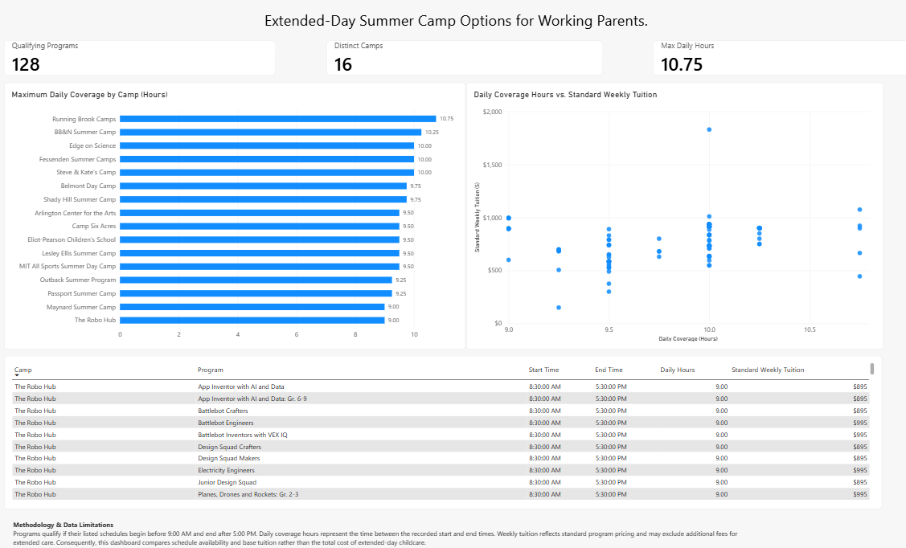

# Analysis 02: Extended-Day Summer Camp Options

This analysis identifies summer camp programs offering schedules that begin before 9:00 AM and end after 5:00 PM.

Using PostgreSQL and Power BI, it compares available daily coverage hours and standard weekly tuition across qualifying programs.

**Key results:**
- 128 qualifying programs
- 16 distinct camps
- 10.75 hours maximum daily coverage

**Limitation:** Standard weekly tuition may not include additional fees for extended care.

## Power BI Dashboard

### Files

- `analysis_02_extended_day.sql` — SQL analysis and validation
- `Analysis_02_Extended_Day_Camps.pbix` — Interactive Power BI report
- `analysis_02_dashboard.png` — Dashboard screenshot
