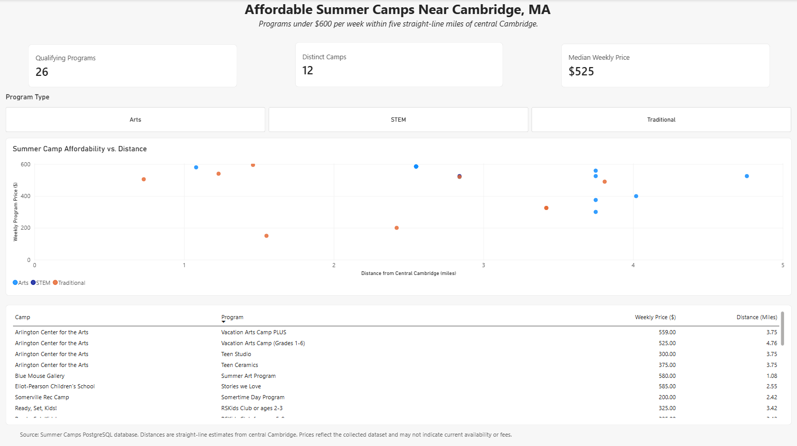

# Boston Summer Camps Database

## Project Overview

A relational PostgreSQL database designed to organize and analyze summer camp programs throughout the Greater Boston area.

The project addresses a practical data challenge: summer camp information is scattered across individual websites, making it difficult for families to compare programs by age eligibility, activities, schedules, availability, and cost.

The database currently contains information on approximately 30 summer camps, encompassing more than 800 program-week offerings and 300 schedule offerings.

## Tools and Technologies

- **PostgreSQL** — Relational database management, data modeling, and SQL analysis
- **pgAdmin 4** — Database administration and schema visualization
- **SQL** — Joins, Common Table Expressions (CTEs), aggregations, filtering, and geographic calculations
- **Power BI Desktop** — Data visualization, interactive dashboards, and reporting
- **DAX** — Custom measures and analytical calculations
- **GitHub** — Version control and project documentation

## Database Architecture

The database consists of eight interconnected tables:

| Table | Purpose |
|---|---|
| `all_camps` | Identifying information about summer camps |
| `programs` | Individual programs offered by camps |
| `activities` | Reference list of activities |
| `program_activities` | Many-to-many relationship between programs and activities |
| `weeks_ref` | Reference table for summer calendar weeks |
| `program_weeks` | Many-to-many relationship between programs and weeks |
| `hours` | Program schedules and operating hours |
| `registration` | Registration dates, deadlines, and related details |

### Entity Relationship Diagram

## Database Design

The database uses relational design principles to organize information efficiently and minimize redundant data.

Notable features include:

- Primary keys identifying individual records
- Seven foreign key relationships enforcing referential integrity
- Junction tables supporting many-to-many relationships
- A composite primary key on `program_activities`
- A uniqueness constraint preventing duplicate program-week combinations

## SQL Schema

The database structure is available in [`sql/summercamps_schema.sql`](sql/summercamps_schema.sql).

This file contains the SQL definitions needed to recreate the underlying database structure without the original dataset.

---

## Analysis 01: Affordable Summer Camps Near Cambridge

### Business Question

Which summer camp programs cost less than $600 per week and are located within five miles of central Cambridge, Massachusetts?

### Dashboard

**Explore the analysis:**

- [View the SQL Analysis](sql/01_affordable_camps_within_5_miles.sql)
- [Download the Power BI Report](powerbi/summer_camps_affordability.pbix)

### Key Findings

Using a sample of Boston-area summer camp programs, the analysis identified:

- **26 qualifying programs** meeting the price and distance criteria
- **12 distinct camps** represented among those programs
- **$525 median weekly price** across qualifying program records

The results demonstrate that families seeking geographically convenient summer programs encounter a range of pricing options, including programs substantially below the $600 weekly budget threshold.

The dashboard allows users to filter results by program type (Arts, STEM, and Traditional) and compare individual programs by price and distance.

### Methodology

I used PostgreSQL to join program-level information with camp information and calculate geographic distances from a central Cambridge reference point.

The SQL query uses:

- **INNER JOIN** to combine related tables
- **Common Table Expressions (CTEs)** to organize calculations
- **Trigonometric functions** to estimate straight-line distances using latitude and longitude
- **Conditional filtering** to identify programs below $600 per week and within five miles
- **Sorting** to organize results by geographic proximity and price

I imported the SQL query results into Power BI Desktop and developed an interactive dashboard featuring:

- A scatter plot comparing weekly program prices and geographic distance
- A detailed program comparison table
- Interactive slicers for filtering by program type
- DAX measures calculating qualifying program counts, distinct camps, and median weekly prices

### Limitations

- Distances are straight-line estimates rather than driving or public transit distances.
- The dataset represents a selected sample of summer camps, not all available camps in Greater Boston.
- Prices reflect the collected data and may not represent current fees or registration availability.
- Age eligibility, program dates, and operating hours are not included in this initial analysis.
- The median price is calculated across individual program records rather than weighting each camp equally.

---

## Future Development

Planned enhancements include:

- Expanding geographic and program coverage
- Developing Python-based data collection and updating workflows
- Exploring AI-assisted extraction of structured information from camp websites
- Incorporating age eligibility, summer-week availability, and scheduling constraints into future analyses
- Developing additional SQL analyses of program offerings, schedules, and pricing
- Expanding Power BI reporting to support more detailed comparisons and interactive exploration

## Project Status

**Active development.**

The relational database architecture and first SQL/Power BI affordability analysis are complete.

Future work includes expanding the dataset, validating program information, and developing additional analyses focused on age eligibility, scheduling, and summer-week availability.
