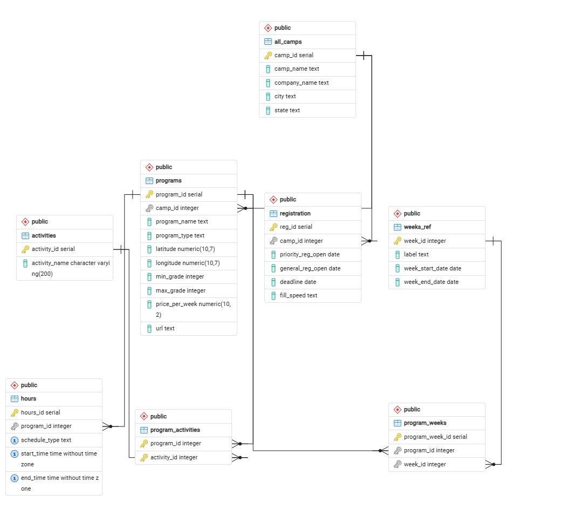

# Boston Summer Camps Database

## Project Overview

A relational PostgreSQL database designed to organize and analyze summer camp programs throughout the Greater Boston area.

The project addresses a practical data challenge: summer camp information is scattered across individual websites, making it difficult for families to compare programs by age eligibility, activities, schedules, availability, and cost.

The database currently contains information on approximately 30 summer camps, encompassing more than 800 program-week offerings and 300 schedule offerings.

## Tools and Technologies

- PostgreSQL
- pgAdmin 4
- SQL
- Entity Relationship Diagrams (ERD)
- Relational Database Design

## Database Architecture

The database consists of eight interconnected tables:

| Table | Purpose |
|---|---|
| `all_camps` | Identifying information about summer camps |
| `programs` | Individual programs offered by camps |
| `activities` | Reference list of activities |
| `program_activities` | Many-to-many relationship between programs and activities |
| `weeks_ref` | Reference table for summer calendar weeks |
| `program_weeks` | Many-to-many relationship between programs and weeks |
| `hours` | Program schedules and operating hours |
| `registration` | Registration dates, deadlines, and related details |

### Entity Relationship Diagram

## Database Design

The database uses relational design principles to organize information efficiently and minimize redundant data.

Notable features include:

- Primary keys identifying individual records
- Seven foreign key relationships enforcing referential integrity
- Junction tables supporting many-to-many relationships
- A composite primary key on `program_activities`
- A uniqueness constraint preventing duplicate program-week combinations

## SQL Schema

The database structure is available in [`sql/summercamps_schema.sql`](sql/summercamps_schema.sql).

This file contains the SQL definitions needed to recreate the underlying database structure without the original dataset.

## Future Development

Planned enhancements include:

- Expanding geographic and program coverage
- Developing Python-based data collection and updating workflows
- Exploring AI-assisted extraction of structured information from camp websites
- Creating analytical SQL queries to compare program offerings, schedules, and pricing
- Developing reporting and visualization tools

## Project Status

Active development. Database architecture complete, with further data collection, validation, and analysis planned.
